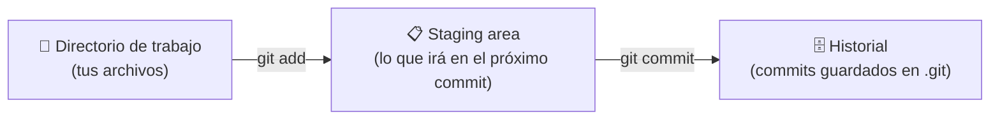

# Módulo 2 · Fundamentos de Git

## Objetivos

- Entender qué es un repositorio y las **tres áreas** de Git.
- Usar `init`, `status`, `add`, `commit` y `log`.
- Ignorar archivos con `.gitignore`.

## 1. ¿Qué es un repositorio?

Un **repositorio** (repo) es una carpeta cuyo historial controla Git. Lo que lo convierte en repo es una
subcarpeta oculta llamada **`.git`**, donde Git guarda todo el historial. Si borras `.git`, la carpeta
vuelve a ser una carpeta normal (y pierdes el historial).

## 2. Las tres áreas



| Área | Qué es | Analogía |
|---|---|---|
| **Directorio de trabajo** | Los archivos que ves y editas | Tu escritorio |
| **Staging** (área de preparación) | Cambios elegidos para el próximo commit | La caja donde metes lo que vas a enviar |
| **Historial** (repositorio) | Commits ya guardados | Paquetes enviados con fecha y etiqueta |

¿Por qué existe el staging? Porque te deja **elegir** qué cambios van juntos en un commit. Si arreglaste
un error y además cambiaste un color, puedes hacer dos commits separados, cada uno con su propio mensaje.

Estados de un archivo:

- **Untracked**: Git no lo conoce todavía.
- **Modified**: cambió desde el último commit, pero no está en staging.
- **Staged**: está en staging, listo para el commit.
- **Committed**: guardado en el historial.

## 3. Comandos básicos

```bash
git init                      # convierte la carpeta actual en un repo
git status                    # ¿qué cambió? ¿qué está en staging?
git add archivo.html          # pasa un archivo a staging
git add .                     # pasa TODOS los cambios de la carpeta a staging
git commit -m "Mensaje"       # guarda lo que está en staging como un commit
git log                       # historial completo
git log --oneline             # historial resumido, un commit por línea
git diff                      # cambios que aún NO están en staging
git diff --staged             # cambios que SÍ están en staging
git restore --staged archivo  # saca un archivo de staging (no pierde los cambios)
git restore archivo           # descarta los cambios de un archivo (¡cuidado, se pierden!)
```

Ejemplo de `git status`:

```
On branch main
Changes to be committed:
  (use "git restore --staged <file>..." to unstage)
        modified:   index.html          ← en staging (verde)

Changes not staged for commit:
  (use "git add <file>..." to update what will be committed)
        modified:   styles.css          ← modificado, sin staging (rojo)

Untracked files:
        notas.txt                       ← Git no lo conoce
```

> **Consejo:** ejecuta `git status` antes y después de cada comando. Es la mejor forma de aprender.

## 4. `.gitignore`

Archivo de texto en la raíz del repo con patrones de archivos que Git debe **ignorar**: dependencias,
archivos generados, contraseñas, archivos del sistema operativo...

```gitignore
# Un archivo concreto
notas.txt

# Todos los archivos con una extensión
*.log

# Una carpeta completa
node_modules/

# Archivos del sistema operativo
.DS_Store
Thumbs.db
```

Puedes ver un `.gitignore` comentado en la raíz de este repo: [`.gitignore`](../../.gitignore).

> `.gitignore` solo afecta a archivos **no rastreados**. Si un archivo ya está en un commit, ignorarlo
> después no lo saca del historial (tendrías que usar `git rm --cached archivo`).

## 🛠️ Práctica: tu primer repositorio

> 📽️ **Slide 10.** Trabaja en la carpeta `curso-git` que descargaste en el módulo 1. Como el ZIP no trae
> historial, todavía no es un repositorio: lo vas a convertir en uno.

1. Entra en la carpeta, inicializa el repo y observa el estado:

   ```bash
   cd ~/curso-git
   git init
   git status          # todos los archivos del curso aparecen como "Untracked"
   ```

2. **Commit 1** – versión inicial:

   ```bash
   git add .
   git status          # ahora aparecen como "Changes to be committed"
   git commit -m "Agrega el material del curso"
   ```

3. **Commit 2** – personaliza la página: abre `proyecto/index.html` y cambia `[tu nombre]` por tu nombre.

   ```bash
   git status          # proyecto/index.html: modified
   git diff            # muestra exactamente qué línea cambió
   git add proyecto/index.html
   git commit -m "Agrega mi nombre a la página"
   ```

4. **Commit 3** – un archivo tuyo: crea `me-gusta.txt` con algo que te guste (una película, una canción,
   una comida, un videojuego...). Una cosa por línea.

   ```bash
   echo "Mi película favorita: El viaje de Chihiro" > me-gusta.txt
   echo "Mi comida favorita: tacos al pastor" >> me-gusta.txt
   git status          # me-gusta.txt aparece como Untracked
   git add me-gusta.txt
   git commit -m "Agrega lo que me gusta"
   ```

   > `>` crea (o sobrescribe) el archivo; `>>` añade una línea al final. También puedes crearlo con tu editor.

5. **Commit 4** – un archivo que **no** quieres guardar en Git:

   ```bash
   echo "Ideas sueltas, no subir" > notas.txt
   git status          # notas.txt aparece como Untracked
   echo "notas.txt" >> .gitignore
   git status          # notas.txt desaparece; .gitignore aparece como modified
   git add .gitignore
   git commit -m "Ignora el archivo de notas personales"
   ```

   > **Ojo con `>>`:** este repo ya trae un `.gitignore`. Con `>` lo sobrescribirías y perderías su contenido.

6. Revisa tu historial:

   ```bash
   git log
   git log --oneline
   ```

### ✅ Comprueba que lo lograste

`git log --oneline` muestra 4 commits (los identificadores serán distintos):

```
d4e5f6a Ignora el archivo de notas personales
c3d4e5f Agrega lo que me gusta
b2c3d4e Agrega mi nombre a la página
a1b2c3d Agrega el material del curso
```

Y `git status` dice `nothing to commit, working tree clean` (aunque `notas.txt` sigue en tu carpeta).

### 🚀 Reto extra

- Agrega una línea a `me-gusta.txt` y otra a `proyecto/index.html`, pero haz **un commit con cada archivo por separado**.
- Prueba `git log -p` (muestra el cambio de cada commit) y `git show HEAD` (el último commit).

---

[← Módulo 1](../01-introduccion/README.md) · [Inicio](../../README.md) · Siguiente: [Módulo 3 · GitHub →](../03-github/README.md)
