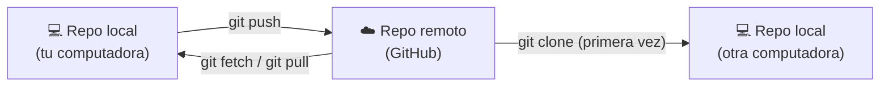

# Módulo 3 · Trabajar con GitHub

## Objetivos

- Crear un repositorio remoto en GitHub.
- Autenticarte con un **token** (HTTPS) o con **SSH**.
- Usar `remote`, `push`, `clone`, `fetch` y `pull`.

## 1. Repositorio local vs. remoto



- Un **remoto** es una copia del repo alojada en otro lugar. Por convención el principal se llama `origin`.
- `push` **sube** tus commits al remoto. `pull` **baja** los commits del remoto y los integra.

## 2. Crear el repositorio en GitHub

1. En GitHub: botón **+** (arriba a la derecha) → **New repository**.
2. Nombre: `mi-pagina`. Visibilidad: pública o privada.
3. **No** marques "Add a README", ".gitignore" ni "license": tu repo local ya tiene historial y el remoto
   debe estar vacío para subirlo sin conflictos.
4. **Create repository**. GitHub muestra la URL del repo, en dos formatos:
   - HTTPS: `https://github.com/tu-usuario/mi-pagina.git`
   - SSH: `git@github.com:tu-usuario/mi-pagina.git`

## 3. Autenticación

GitHub **no acepta tu contraseña** desde la terminal. Elige una de estas dos opciones.

### Opción A: HTTPS + token personal (más rápido para empezar)

1. GitHub → foto de perfil → **Settings** → **Developer settings** → **Personal access tokens** →
   **Fine-grained tokens** → **Generate new token**.
2. Nombre: `curso-git`. Expiración: 30 días. Repository access: **All repositories** (o solo `mi-pagina`).
3. Permissions → Repository permissions → **Contents: Read and write**.
4. Genera el token y **cópialo ya** (no podrás volver a verlo).
5. La primera vez que hagas `push`, usa el token como contraseña.

> **Windows:** Git for Windows incluye *Git Credential Manager*: al hacer `push` se abre una ventana para
> iniciar sesión en GitHub desde el navegador y recuerda tus credenciales. Normalmente no necesitas el token.
>
> **macOS:** las credenciales se guardan en el Llavero automáticamente.
> **Linux:** `git config --global credential.helper store` las guarda (en texto plano) tras el primer uso.

### Opción B: SSH (recomendada a largo plazo)

```bash
# 1. Generar un par de llaves (pulsa Enter para aceptar la ruta por defecto)
ssh-keygen -t ed25519 -C "tu@correo.com"

# 2. Mostrar la llave PÚBLICA y copiarla
cat ~/.ssh/id_ed25519.pub
```

3. GitHub → **Settings** → **SSH and GPG keys** → **New SSH key** → pega la llave pública.
4. Prueba la conexión:

```bash
ssh -T git@github.com
# Hi tu-usuario! You've successfully authenticated...
```

> Nunca compartas el archivo **sin** `.pub` (`id_ed25519`): es tu llave privada.

## 4. Comandos

```bash
git remote add origin <URL>     # conecta tu repo local con el remoto
git remote -v                   # lista los remotos configurados
git push -u origin main         # primer push: sube main y la deja "enlazada" con origin/main
git push                        # pushes siguientes (gracias a -u)
git clone <URL>                 # descarga un repo completo (crea la carpeta)
git fetch                       # descarga commits nuevos del remoto SIN tocar tus archivos
git pull                        # fetch + integrar los cambios en tu rama actual
```

### `fetch` vs. `pull`

| `git fetch` | `git pull` |
|---|---|
| Descarga los commits nuevos | Descarga **e integra** los commits nuevos |
| Actualiza `origin/main`, no tu `main` | Actualiza tu `main` |
| Seguro: nunca cambia tus archivos | Puede generar conflictos |
| Útil para **revisar** antes de integrar | Útil cuando ya sabes que quieres los cambios |

`git pull` = `git fetch` + `git merge origin/main`.

## 🛠️ Práctica: sube tu repo a GitHub

1. Crea el repo vacío `mi-pagina` en GitHub (sección 2).
2. Configura tu autenticación (opción A o B).
3. Desde la carpeta de tu repo del módulo 2:

   ```bash
   cd ~/mi-pagina
   git remote add origin <URL-de-tu-repo>
   git remote -v
   git push -u origin main
   ```

4. Recarga la página del repo en GitHub: verás tus archivos y tus 4 commits (enlace **commits**).
5. **Simula un cambio de otra persona:** en GitHub abre `index.html` → ícono del lápiz (✏️) → cambia el
   texto del `<footer>` → **Commit changes** (deja el mensaje que propone o escribe uno).
6. Trae ese cambio a tu computadora, primero revisando y luego integrando:

   ```bash
   git fetch
   git status                        # "Your branch is behind 'origin/main' by 1 commit"
   git log --oneline main..origin/main   # commits que están en el remoto y tú no tienes
   git pull
   git log --oneline                 # ahora tu historial incluye el commit hecho en GitHub
   ```

7. Haz un cambio local (por ejemplo, el `.lema` del `<header>`), commit y `git push`.

### ✅ Comprueba que lo lograste

- `git status` dice `Your branch is up to date with 'origin/main'`.
- En GitHub ves 6 commits, incluido el que hiciste desde la web.

### 🚀 Reto extra

Clona tu propio repo en otra carpeta (`git clone <URL> mi-pagina-copia`), haz un commit desde ahí, súbelo
y luego haz `git pull` en la carpeta original. Acabas de simular a dos personas colaborando.

---

[← Módulo 2](../02-fundamentos/README.md) · [Inicio](../../README.md) · Siguiente: [Módulo 4 · Ramas →](../04-ramas/README.md)
