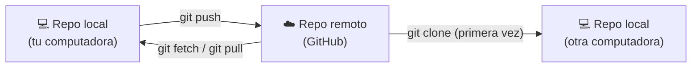

# Módulo 3 · Trabajar con GitHub

## Objetivos

- Crear un repositorio remoto en GitHub.
- Autenticarte iniciando sesión en el navegador (o, como alternativa, con un **token** o **SSH**).
- Usar `remote`, `push`, `clone`, `fetch` y `pull`.

## 1. Repositorio local vs. remoto



- Un **remoto** es una copia del repo alojada en otro lugar. Por convención el principal se llama `origin`.
- `push` **sube** tus commits al remoto. `pull` **baja** los commits del remoto y los integra.

## 2. Crear el repositorio en GitHub

1. En GitHub: botón **+** (arriba a la derecha) → **New repository**.
2. Elige un nombre y la visibilidad (pública o privada).
3. **No** marques "Add a README", ".gitignore" ni "license": tu repo local ya tiene historial y el remoto
   debe estar vacío para subirlo sin conflictos.
4. **Create repository**. GitHub muestra la URL del repo, en dos formatos:
   - HTTPS: `https://github.com/tu-usuario/curso-git.git`
   - SSH: `git@github.com:tu-usuario/curso-git.git`

## 3. Autenticación

GitHub **no acepta tu contraseña** escrita en la terminal. La forma más fácil es iniciar sesión en el navegador.

### Recomendado: iniciar sesión en el navegador

**Git Credential Manager** se encarga de todo. La primera vez que hagas `git push`:

1. Se abre una ventana **Connect to GitHub** → pulsa **Sign in with your browser**.
2. El navegador abre GitHub: inicia sesión con tu usuario y contraseña de siempre.
3. Pulsa **Authorize git-ecosystem** (el permiso para Git Credential Manager).
4. Vuelve a la terminal: el `push` continúa solo. Tus credenciales quedan guardadas y no te las vuelve a pedir.

| Sistema | Qué necesitas |
|---|---|
| **Windows** | Nada: viene incluido en Git for Windows. |
| **macOS** | `brew install --cask git-credential-manager` |
| **Linux** | Lo más sencillo es la CLI de GitHub: instala `gh`, ejecuta `gh auth login` (elige *GitHub.com → HTTPS → Login with a web browser*) y luego `gh auth setup-git`. |

> ¿No se abre la ventana? Usa una de las alternativas de abajo.

### Alternativa A: HTTPS + token personal

1. GitHub → foto de perfil → **Settings** → **Developer settings** → **Personal access tokens** →
   **Fine-grained tokens** → **Generate new token**.
2. Nombre: `token-curso`. Expiración: 30 días. Repository access: **All repositories** (o solo `curso-git`).
3. Permissions → Repository permissions → **Contents: Read and write**.
4. Genera el token y **cópialo ya** (no podrás volver a verlo).
5. La primera vez que hagas `push`, usa el token como contraseña.

### Alternativa B: SSH

```bash
# 1. Generar un par de llaves (pulsa Enter para aceptar la ruta por defecto)
ssh-keygen -t ed25519 -C "tu@correo.com"

# 2. Mostrar la llave PÚBLICA y copiarla
cat ~/.ssh/id_ed25519.pub
```

3. GitHub → **Settings** → **SSH and GPG keys** → **New SSH key** → pega la llave pública.
4. Prueba la conexión:

```bash
ssh -T git@github.com
# Hi tu-usuario! You've successfully authenticated...
```

> Nunca compartas el archivo **sin** `.pub` (`id_ed25519`): es tu llave privada.

## 4. Comandos

```bash
git remote add origin <URL>     # conecta tu repo local con el remoto
git remote -v                   # lista los remotos configurados
git push -u origin main         # primer push: sube main y la deja "enlazada" con origin/main
git push                        # pushes siguientes (gracias a -u)
git clone <URL>                 # descarga un repo completo (crea la carpeta)
git fetch                       # descarga commits nuevos del remoto SIN tocar tus archivos
git pull                        # fetch + integrar los cambios en tu rama actual
```

### `fetch` vs. `pull`

| `git fetch` | `git pull` |
|---|---|
| Descarga los commits nuevos | Descarga **e integra** los commits nuevos |
| Actualiza `origin/main`, no tu `main` | Actualiza tu `main` |
| Seguro: nunca cambia tus archivos | Puede generar conflictos |
| Útil para **revisar** antes de integrar | Útil cuando ya sabes que quieres los cambios |

`git pull` = `git fetch` + `git merge origin/main`.

## 🛠️ Práctica: sube tus gustos al repo del curso

> 📽️ **Slide 15.** No creas un repo nuevo: subes tus commits **al repo del curso** con un Pull Request
> a `main`. Tu `origin` ya apunta ahí porque lo clonaste en el módulo 2.

1. **Acepta la invitación** del instructor para ser colaborador: te llega por correo o en
   <https://github.com/Asis41/curso-git/invitations>.
2. Autenticación: no tienes que preparar nada. En el paso 3, al hacer `git push`, se abrirá el navegador
   para que inicies sesión en GitHub (sección 3). En macOS/Linux instala antes lo que indica su tabla.
3. Intenta subir directo a `main`:

   ```bash
   cd ~/curso-git
   git remote -v       # origin → github.com/Asis41/curso-git
   git push
   # remote: - Changes must be made through a pull request.
   ```

   **Rechazado, y es a propósito:** `main` está protegida, nadie sube directo. (Si ves
   `rejected ... (fetch first)` es porque alguien ya actualizó `main`: también te impide subir.) Los cambios entran por Pull
   Request (lo verás a fondo en el módulo 6).

4. Sube tus commits en una rama con tu usuario (las ramas se explican en el módulo 4; por ahora basta con esto):

   ```bash
   git switch -c alumno/tu-usuario
   git push -u origin alumno/tu-usuario
   ```

5. En GitHub aparece un aviso amarillo **Compare & pull request**: púlsalo. Comprueba que dice
   **base: main ← compare: alumno/tu-usuario**, escribe un título ("Agrega los gustos de tu-usuario") y
   **Create pull request**. En **Files changed** verás tu archivo de gustos y la línea de `.gitignore`;
   `notas.txt` **no** está.
6. Espera a que el instructor fusione tu PR. Luego trae a tu computadora lo que hay en `main`, incluidos
   los gustos de tus compañeros, primero revisando y luego integrando:

   ```bash
   git switch main
   git fetch
   git status                            # "Your branch is behind 'origin/main' by N commits"
   git log --oneline main..origin/main   # commits que están en GitHub y tú no tienes
   git pull
   ls gustos/                            # ¡los archivos de tus compañeros!
   ```

### ✅ Comprueba que lo lograste

- Tu PR aparece en **Pull requests → Closed** como *Merged*.
- `ls gustos/` muestra tu archivo y los de tus compañeros.
- `git status` dice `Your branch is up to date with 'origin/main'`.

### 🚀 Reto extra

Clona el repo en otra carpeta (`git clone <URL> curso-git-copia`), y compara: `git log --oneline` es igual
en las dos carpetas porque ambas copian el mismo `main` de GitHub.

---

[← Módulo 2](../02-fundamentos/README.md) · [Inicio](../../README.md) · Siguiente: [Módulo 4 · Ramas →](../04-ramas/README.md)
