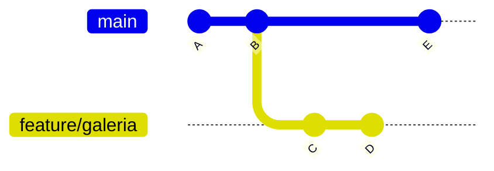

# Módulo 4 · Ramas: el concepto central

## Objetivos

- Entender qué es una **rama** y qué es **HEAD**.
- Saber por qué se trabaja en ramas.
- Crear, cambiar, listar, renombrar, borrar y subir ramas.

## 1. ¿Qué es una rama?

Cada commit apunta a su commit anterior (su "padre"), formando una cadena. Una **rama** es simplemente
una **etiqueta móvil que apunta a un commit**. Cuando haces un commit nuevo, la etiqueta de la rama en la
que estás avanza a ese commit.

Crear una rama es instantáneo y no copia archivos: solo crea una etiqueta nueva.



Aquí `main` apunta a `E` y `feature/galeria` apunta a `D`. Ambas comparten la historia `A → B`.

## 2. ¿Qué es HEAD?

**HEAD** indica **dónde estás ahora**: normalmente apunta a la rama actual. Al cambiar de rama, HEAD se
mueve y Git cambia los archivos de tu carpeta para que coincidan con esa rama.

```
            HEAD
             ↓
           main
             ↓
A ← B ← ─ ─ E
         ↖
           C ← D
               ↑
        feature/galeria
```

Si haces `git switch feature/galeria`, HEAD pasa a apuntar a `feature/galeria` y tus archivos muestran el
estado del commit `D`.

> Si ves el mensaje **"detached HEAD"**, HEAD apunta directamente a un commit y no a una rama (pasa al hacer
> `git checkout <id-de-commit>`). Para volver: `git switch main`.

## 3. ¿Por qué trabajar en ramas?

- **`main` siempre funciona**: los experimentos viven en su propia rama hasta que estén listos.
- **Trabajo en paralelo**: cada persona o cada tarea en su rama, sin estorbarse.
- **Revisión**: una rama es una unidad de trabajo que se puede revisar en un Pull Request (módulo 6).
- **Descartar es barato**: si la idea no funciona, borras la rama y `main` queda intacto.

## 4. Comandos

```bash
# Listar
git branch                    # ramas locales (* marca la actual)
git branch -a                 # locales y remotas
git branch -v                 # con el último commit de cada una

# Crear y cambiar
git branch feature/galeria    # crea la rama (pero sigues en la actual)
git switch feature/galeria    # cambia a la rama
git switch -c feature/galeria # crea Y cambia en un paso (lo más común)
git switch -                  # vuelve a la rama anterior

# Renombrar
git branch -m nombre-nuevo             # renombra la rama actual
git branch -m viejo nuevo              # renombra otra rama

# Borrar
git branch -d feature/galeria  # borra (solo si ya está fusionada)
git branch -D feature/galeria  # fuerza el borrado (¡se pierden sus commits no fusionados!)

# Remoto
git push -u origin feature/galeria       # sube la rama y la enlaza
git push origin --delete feature/galeria # borra la rama en GitHub
git fetch --prune                        # limpia referencias a ramas remotas ya borradas
```

### `switch` vs. `checkout`

`git checkout` es el comando antiguo y hace muchas cosas distintas (cambiar de rama, restaurar archivos...).
Desde Git 2.23 existen `git switch` (ramas) y `git restore` (archivos), más claros. Verás `checkout` en
tutoriales y en internet, así que conviene reconocerlo:

| Moderno | Equivalente con `checkout` |
|---|---|
| `git switch rama` | `git checkout rama` |
| `git switch -c rama` | `git checkout -b rama` |
| `git restore archivo` | `git checkout -- archivo` |

> **Antes de cambiar de rama**, haz commit de tus cambios (o guárdalos con `git stash`). Si no, Git puede
> negarse a cambiar o llevarse tus cambios a la otra rama.

## 🛠️ Práctica: tu propio estilo en tu propia rama

> 📽️ **Slide 19.** Trabaja en tu carpeta `curso-git`. La página [`proyecto/index.html`](../../proyecto/index.html)
> tiene el HTML y el CSS (dentro de `<style>`) en un solo archivo.

1. Asegúrate de estar al día en `main`:

   ```bash
   git switch main
   git pull
   ```

2. Crea tu rama de estilo (cambia `tu-usuario` por tu usuario de GitHub):

   ```bash
   git switch -c estilo/tu-usuario
   git branch          # * estilo/tu-usuario
   ```

3. **Pídele un estilo a una IA.** Abre `proyecto/index.html` en tu editor, copia **todo** su contenido y
   pégalo en tu IA de preferencia (Claude, ChatGPT, Gemini, Copilot...) junto con lo que quieras cambiar.
   Por ejemplo, a Claude:

   > Cambia los colores a rojo y agrega un recuadro al título. Devuélveme el archivo completo.

   Cada quien pide su propio estilo: fondo oscuro, otra tipografía, bordes redondeados, tus colores
   favoritos... Reemplaza el contenido de `proyecto/index.html` por la respuesta, guarda y ábrelo en el navegador.

4. Revisa qué cambió la IA y haz commit:

   ```bash
   git diff            # las líneas que cambió la IA
   git commit -am "Cambia el estilo de la página"
   ```

   ¿No te convence? Pídele otro ajuste y haz otro commit: cada intento queda guardado.

5. **Observa cómo cambian tus archivos según la rama** (recarga el navegador después de cada comando):

   ```bash
   git switch main     # la página vuelve al estilo original
   git switch -        # vuelve a estilo/tu-usuario: tu estilo aparece
   ```

6. Mira el historial de todas las ramas:

   ```bash
   git log --oneline --graph --all
   ```

7. Sube la rama a GitHub:

   ```bash
   git push -u origin estilo/tu-usuario
   ```

   En GitHub, el selector de ramas (arriba a la izquierda, dice `main`) ahora muestra tu rama y las de tus
   compañeros. **No abras un Pull Request con esta rama:** todos cambiaron el mismo archivo.

8. Practica renombrar y borrar con una rama de prueba:

   ```bash
   git branch prueba
   git branch -m prueba experimento
   git branch            # aparece "experimento"
   git branch -d experimento
   ```

> No fusiones todavía tu rama de estilo en `main`: eso es el módulo 5.

### ✅ Comprueba que lo lograste

`git log --oneline --graph --all` muestra tu rama un commit por delante de `main`:

```
* 9f8e7d6 (HEAD -> estilo/tu-usuario, origin/estilo/tu-usuario) Cambia el estilo de la página
*   7d6c5b4 (origin/main, main) Merge pull request #12 from Asis41/alumno/tu-usuario
* ...
```

### 🚀 Reto extra

Desde `main`, crea otra rama `estilo2/tu-usuario` y pide a la IA un estilo completamente distinto. Alterna
entre las dos ramas en el navegador y mira `git log --oneline --graph --all`: dos ramas que salen del mismo punto.

---

[← Módulo 3](../03-github/README.md) · [Inicio](../../README.md) · Siguiente: [Módulo 5 · Merge y conflictos →](../05-merge-y-conflictos/README.md)
