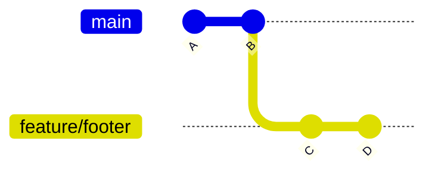
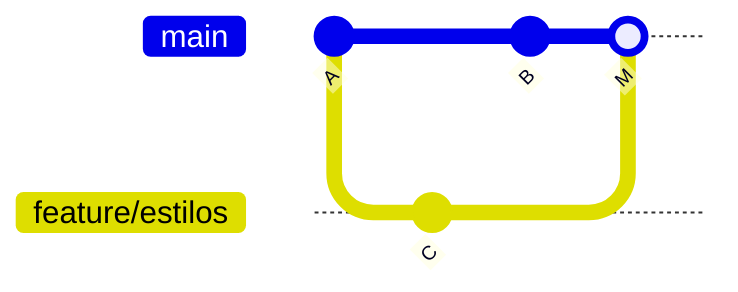
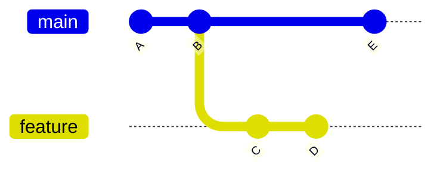

# Módulo 5 · Fusión de ramas y conflictos

## Objetivos

- Distinguir un merge **fast-forward** de un merge **con commit**.
- Leer y resolver un **conflicto** paso a paso.
- Saber qué es **rebase** y cuándo usarlo (o no).

## 1. `git merge`

`git merge <rama>` trae los commits de `<rama>` **a la rama en la que estás**. Primero te cambias a la rama
que recibe los cambios (normalmente `main`) y luego haces merge de la otra:

```bash
git switch main
git merge feature/galeria
```

### Fast-forward

Si `main` **no avanzó** desde que se creó la rama, Git solo tiene que "adelantar" la etiqueta `main` hasta
el último commit de la rama. No se crea ningún commit nuevo.



Después de `git merge feature/footer`: `main` simplemente pasa a apuntar a `D`. El historial queda lineal.

```
Updating 3109e98..04cb8df
Fast-forward
```

### Merge con commit (three-way merge)

Si **ambas ramas avanzaron**, Git crea un **commit de merge** que tiene dos padres y une las dos historias.



```
Merge made by the 'ort' strategy.
```

Git abre tu editor para el mensaje del commit de merge (puedes aceptar el que propone). Para no abrir el
editor: `git merge --no-edit feature/estilos`.

> Puedes forzar un commit de merge aunque sea posible el fast-forward con `git merge --no-ff rama`.
> Algunos equipos lo prefieren para que quede registro de que existió la rama.

## 2. Conflictos

Hay un **conflicto** cuando las dos ramas cambiaron **las mismas líneas** del mismo archivo (o una borró un
archivo que la otra modificó). Git no puede decidir cuál versión es la buena, así que te pregunta a ti.

```
Auto-merging index.html
CONFLICT (content): Merge conflict in index.html
Automatic merge failed; fix conflicts and then commit the result.
```

Un conflicto **no es un error**: es Git pidiéndote una decisión. Nada se ha perdido.

### Cómo leer un conflicto

Git escribe **las dos versiones** en el archivo, separadas por marcadores:

```html
  <header>
<<<<<<< HEAD
    <h1>Equipo Azul</h1>
=======
    <h1>Equipo Rojo</h1>
>>>>>>> feature/titulo-rojo
    <p class="lema">Aprendiendo Git y GitHub, un commit a la vez.</p>
```

| Marcador | Significado |
|---|---|
| `<<<<<<< HEAD` | Empieza **tu** versión (la de la rama donde estás, p. ej. `main`) |
| `=======` | Separa las dos versiones |
| `>>>>>>> feature/titulo-rojo` | Termina la versión de **la rama que estás fusionando** |

### Resolver paso a paso

1. **Identifica** los archivos en conflicto:

   ```bash
   git status
   # Unmerged paths:
   #         both modified:   index.html
   ```

2. **Abre el archivo** y busca `<<<<<<<`.
3. **Decide** el resultado final. Puedes quedarte con una versión, con la otra, o combinar ambas
   (p. ej. `<h1>Equipo Azul y Rojo</h1>`).
4. **Borra los tres marcadores** (`<<<<<<<`, `=======`, `>>>>>>>`). El archivo debe quedar como quieres que
   se vea, sin rastro de los marcadores.
5. **Marca el conflicto como resuelto** y termina el merge:

   ```bash
   git add index.html
   git commit          # o: git commit --no-edit
   ```

¿Te arrepentiste a mitad? Vuelve a como estaba todo antes del merge:

```bash
git merge --abort
```

> **VS Code** resalta los conflictos y ofrece botones: *Accept Current Change* (HEAD), *Accept Incoming
> Change* (la otra rama), *Accept Both Changes*. Úsalos, pero revisa siempre el resultado.

## 3. Introducción a rebase

`git rebase main` (estando en tu rama) **reescribe** tus commits como si los hubieras hecho a partir del
último commit de `main`. El resultado es un historial lineal, sin commits de merge.



Después de `git switch feature` y `git rebase main`, los commits `C` y `D` se recrean encima de `E`
como `C'` y `D'` (commits **nuevos**, con otros identificadores):

```
A ← B ← E ← C' ← D'
            ↑      ↑
          main   feature
```

| Merge | Rebase |
|---|---|
| Conserva la historia tal como ocurrió | Reescribe la historia para que sea lineal |
| Crea commits de merge | No crea commits de merge |
| Seguro siempre | Peligroso en ramas compartidas |

**Regla de oro:** nunca hagas rebase de commits que **ya subiste** y que otras personas pueden estar usando.
Al reescribirlos, sus copias dejan de coincidir con la tuya.

**Cuándo sí:** para actualizar **tu** rama local (aún no compartida) con lo último de `main` antes de abrir un
Pull Request. **En duda, usa merge.**

## 🛠️ Práctica: provocar y resolver un conflicto

> 📽️ **Slide 25.**

### Parte A: los tres tipos de merge con el script

Desde tu carpeta `curso-git`:

```bash
bash scripts/escenario-merge.sh
```

El script crea la carpeta `../practica-merge` (junto a tu `curso-git`, no dentro) con un repo y estas ramas:

| Rama | Qué cambia | Qué pasará al fusionarla |
|---|---|---|
| `feature/footer` | Texto del footer | Fast-forward |
| `feature/estilos` | Color de fondo, en el `<style>` | Merge con commit |
| `feature/titulo-azul` | El `<h1>` | Merge sin conflicto |
| `feature/titulo-rojo` | El mismo `<h1>` | **Conflicto** |

```bash
cd ../practica-merge
git log --oneline --graph --all      # observa las ramas ANTES de fusionar

git merge feature/footer             # 1. ¿Dice "Fast-forward"?
git log --oneline --graph --all

git merge feature/estilos            # 2. Se abre el editor: guarda y cierra
git log --oneline --graph --all      #    observa el commit de merge con dos padres

git merge feature/titulo-azul        # 3. Merge sin conflicto
git merge feature/titulo-rojo        # 4. ¡Conflicto!
```

Resuelve el conflicto siguiendo los pasos de la sección 2 (decide tú el título final) y termina con
`git add index.html` y `git commit`.

> ¿Quieres repetir la práctica? Borra la carpeta `practica-merge` y vuelve a ejecutar el script, o pásale
> otra carpeta: `bash scripts/escenario-merge.sh ../practica-merge-2`.

### Parte B: provócalo tú mismo en tu `curso-git`

Todo esto ocurre **solo en tu computadora**: no hagas `git push` de `main` (está protegida, y tu estilo
es solo tuyo).

Primero integra tu rama de estilo del módulo 4:

```bash
cd ~/curso-git
git switch main
git merge estilo/tu-usuario          # fast-forward: tu main ya tiene tu estilo
```

Ahora dos ramas van a cambiar **la primera línea de tu archivo de gustos**:

```bash
git switch -c gusto-a
# con tu editor, cambia la PRIMERA línea de gustos/tu-usuario.txt (p. ej. otra película)
git commit -am "Cambia mi película favorita"

git switch main
git switch -c gusto-b
# cambia LA MISMA primera línea, con un texto distinto
git commit -am "Cambia mi película favorita por otra"

git switch main
git merge gusto-a                    # fast-forward
git merge gusto-b                    # ¡CONFLICTO en gustos/tu-usuario.txt!
```

Abre `gustos/tu-usuario.txt`, decide qué queda (¿por qué no las dos películas?), borra los marcadores y termina:

```bash
git add gustos/tu-usuario.txt
git commit --no-edit
git branch -d gusto-a gusto-b        # limpia las ramas fusionadas
```

### ✅ Comprueba que lo lograste

En `practica-merge`, `git log --oneline --graph` muestra algo así y `git status` está limpio:

```
*   200fba6 (HEAD -> main) Merge branch 'feature/titulo-rojo'
|\
| * 60f9bae (feature/titulo-rojo) Renombra el título a Equipo Rojo
* |   dacc22e Merge branch 'feature/titulo-azul'
|\ \
| * | 763b709 (feature/titulo-azul) Renombra el título a Equipo Azul
| |/
* |   2d1ac44 Merge branch 'feature/estilos'
|\ \
| * | 8f0a598 (feature/estilos) Cambia el color de fondo
* | | 8adbf59 (feature/footer) Agrega agradecimiento al footer
| |/
|/|
* | ebe3fdf Actualiza el lema
|/
* 64c583f Versión inicial de la página
```

(Los identificadores de tus commits serán distintos.)

Y `index.html` **no contiene** ningún `<<<<<<<`, `=======` ni `>>>>>>>`:

```bash
grep -n "<<<<<<<\|>>>>>>>" index.html   # no debe imprimir nada
```

En tu `curso-git` (Parte B), lo mismo con `gustos/tu-usuario.txt`, y `git log --oneline --graph` muestra
el commit de merge.

### 🚀 Reto extra

En un nuevo escenario (`bash scripts/escenario-merge.sh ../practica-rebase`), en lugar de hacer merge de
`feature/estilos`, haz `git switch feature/estilos` y `git rebase main`. Compara el `git log --graph` con
el de la Parte A.

---

[← Módulo 4](../04-ramas/README.md) · [Inicio](../../README.md) · Siguiente: [Módulo 6 · Pull Requests →](../06-pull-requests/README.md)
