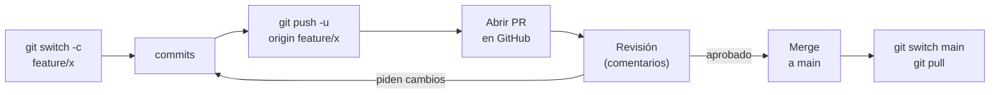

# Módulo 6 · Colaboración con Pull Requests

## Objetivos

- Seguir el flujo completo: rama → push → Pull Request → revisión → merge.
- Revisar código: comentarios, sugerencias de cambio, aprobar o pedir cambios.
- Proteger la rama `main`.

## 1. ¿Qué es un Pull Request?

Un **Pull Request** (PR) es una **propuesta** en GitHub para fusionar una rama en otra (normalmente en
`main`). Antes de fusionar, el equipo puede ver los cambios, comentarlos y pedir ajustes.

El PR no es un comando de Git: es una función de GitHub (en GitLab se llama *Merge Request*).



## 2. El flujo paso a paso

1. **Actualiza `main`** y crea tu rama:

   ```bash
   git switch main
   git pull
   git switch -c feature/seccion-contacto
   ```

2. **Haz commits** pequeños y con buenos mensajes.
3. **Sube la rama:** `git push -u origin feature/seccion-contacto`
4. **Abre el PR:** GitHub muestra un aviso amarillo *"feature/seccion-contacto had recent pushes"* →
   **Compare & pull request**. (O bien: pestaña **Pull requests** → **New pull request**.)
   - **base:** `main` (dónde quieres fusionar) ← **compare:** tu rama.
   - **Título** claro y **descripción**: qué cambia, por qué, cómo probarlo. Este repo incluye una
     plantilla en [`.github/pull_request_template.md`](../../.github/pull_request_template.md). Tu
     `curso-git` ya la incluye, así que GitHub la usa al abrir cada PR.
   - **Reviewers** (panel derecho): elige a quién le pides la revisión.
5. **Revisión** (sección 3). Si te piden cambios: haz commits nuevos **en la misma rama** y `git push`;
   el PR se actualiza solo.
6. **Merge:** cuando esté aprobado, botón **Merge pull request** → **Delete branch**.
7. **Actualiza tu copia local:**

   ```bash
   git switch main
   git pull
   git branch -d feature/seccion-contacto
   git fetch --prune
   ```

## 3. Revisar un Pull Request

En el PR, pestaña **Files changed**:

- **Comentar una línea:** pasa el ratón sobre la línea y pulsa el **+** azul.
- **Sugerir un cambio:** al comentar, pulsa el ícono de **sugerencia** (±) o escribe:

  ````markdown
  ```suggestion
      <h2>Contáctame</h2>
  ```
  ````

  El autor del PR puede aplicarla con un clic (**Commit suggestion**) y se crea un commit en su rama.

- **Terminar la revisión:** botón **Review changes** (arriba a la derecha) y elige:

  | Opción | Cuándo |
  |---|---|
  | **Comment** | Comentarios generales, sin aprobar ni bloquear |
  | **Approve** | Todo bien, se puede fusionar |
  | **Request changes** | Hay que corregir algo antes de fusionar |

**Buenas prácticas al revisar:** comenta el código, no a la persona; explica el *porqué*; distingue lo
obligatorio de lo opcional (p. ej. prefijo "nit:" para detalles menores); reconoce lo que está bien.

## 4. Formas de fusionar un PR

El botón **Merge pull request** tiene un desplegable con tres opciones:

| Opción | Resultado en `main` |
|---|---|
| **Create a merge commit** | Todos los commits de la rama + un commit de merge |
| **Squash and merge** | Todos los commits de la rama se combinan en **uno solo** |
| **Rebase and merge** | Los commits de la rama se copian encima de `main`, sin commit de merge |

*Squash and merge* es muy popular: deja en `main` un commit por PR, con historial limpio.

## 5. Proteger la rama `main`

Para que **nadie pueda subir directamente a `main`** y todo pase por un PR revisado:

1. Repo → **Settings** → **Rules** → **Rulesets** → **New ruleset** → **New branch ruleset**.
2. **Ruleset name:** `proteger-main`. **Enforcement status:** **Active**.
3. **Target branches** → **Add target** → **Include default branch**.
4. Marca:
   - ✅ **Restrict deletions**
   - ✅ **Require a pull request before merging** → *Required approvals*: **1**
   - ✅ **Block force pushes**
5. **Create**.

Ahora `git push` directo a `main` es rechazado:

```
remote: error: GH013: Repository rule violations found for refs/heads/main.
remote: - Changes must be made through a pull request.
```

> En la interfaz antigua esto está en **Settings → Branches → Add branch protection rule**, con opciones
> equivalentes. Las reglas en repos **privados** requieren un plan de pago; en repos **públicos** son gratis.

## 🛠️ Práctica en parejas

> 📽️ **Slide 30.** Persona **A** y persona **B** trabajan sobre el `curso-git` de A.

### Preparación (lo hace A)

1. A usa su repo `curso-git` de los módulos anteriores. Debe ser **público** para poder proteger `main`
   con una cuenta gratuita (Settings → General → Danger Zone → Change visibility, si no lo es).
2. **Settings → Collaborators → Add people** → agrega a B. B acepta la invitación (le llega por correo o
   en <https://github.com/notifications>).
3. A protege `main` (sección 5) con 1 aprobación requerida.
4. B clona el repo de A:

   ```bash
   git clone <URL-del-repo-de-A> curso-git-de-A
   cd curso-git-de-A
   ```

### Cada quien abre un PR

Cada persona crea su rama y cambia **archivos distintos** (así no hay conflicto):

| | Rama | Cambio |
|---|---|---|
| **A** | `feature/seccion-contacto` | Agrega una sección "Contacto" antes de `</main>` en `proyecto/index.html` |
| **B** | `feature/gustos-<tu-nombre>` | Crea `me-gusta-<tu-nombre>.txt` con 3 cosas que le gustan |

Al abrir el PR, la descripción ya viene rellena con la plantilla de `.github/pull_request_template.md`.

1. Rama → commit(s) → `git push -u origin <rama>` → abrir PR → asignar a la otra persona como *reviewer*.
2. Intenta hacer `git push` directo a `main` y comprueba que es rechazado.

### Cada quien revisa el PR del otro

En el PR de tu compañero/a:

1. Deja **al menos un comentario** en una línea concreta.
2. Deja **al menos una sugerencia** con el botón de sugerencia (±).
3. Termina con **Request changes**.

Luego, en tu propio PR:

4. Aplica la sugerencia que te hicieron (**Commit suggestion**) y responde a los comentarios.
5. Pide de nuevo la revisión (ícono 🔄 junto al nombre del reviewer).
6. El revisor aprueba con **Approve**.
7. Fusiona tu PR con **Squash and merge** y borra la rama.
8. Ambos actualizan su copia local: `git switch main` y `git pull`.

> Si el segundo PR dice *"This branch is out-of-date with the base branch"*, pulsa **Update branch**.
> Si hay conflictos, GitHub te deja resolverlos en el navegador (**Resolve conflicts**) o hazlo en local:
> `git switch tu-rama`, `git merge main`, resuelve (módulo 5) y `git push`.

### ✅ Comprueba que lo lograste

- En la pestaña **Pull requests → Closed** hay 2 PRs fusionados, cada uno con comentarios, una sugerencia
  aplicada y una aprobación.
- `git log --oneline` en `main` muestra un commit por PR (por el *squash*).
- Un `git push` directo a `main` es rechazado.

### 🚀 Reto extra

- Cambien los papeles: B crea un repo, protege `main` y repiten el ejercicio.
- Hagan que los dos PRs modifiquen **la misma línea** y resuelvan el conflicto en GitHub.

---

[← Módulo 5](../05-merge-y-conflictos/README.md) · [Inicio](../../README.md) · Siguiente: [Módulo 7 · Estrategias y buenas prácticas →](../07-estrategias/README.md)
