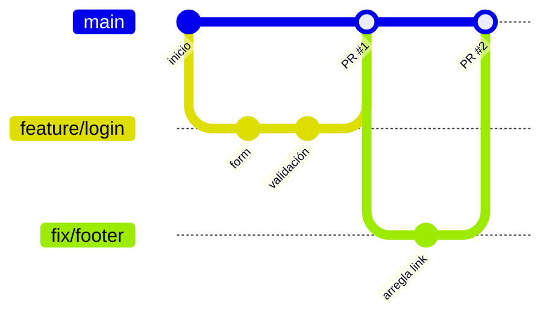
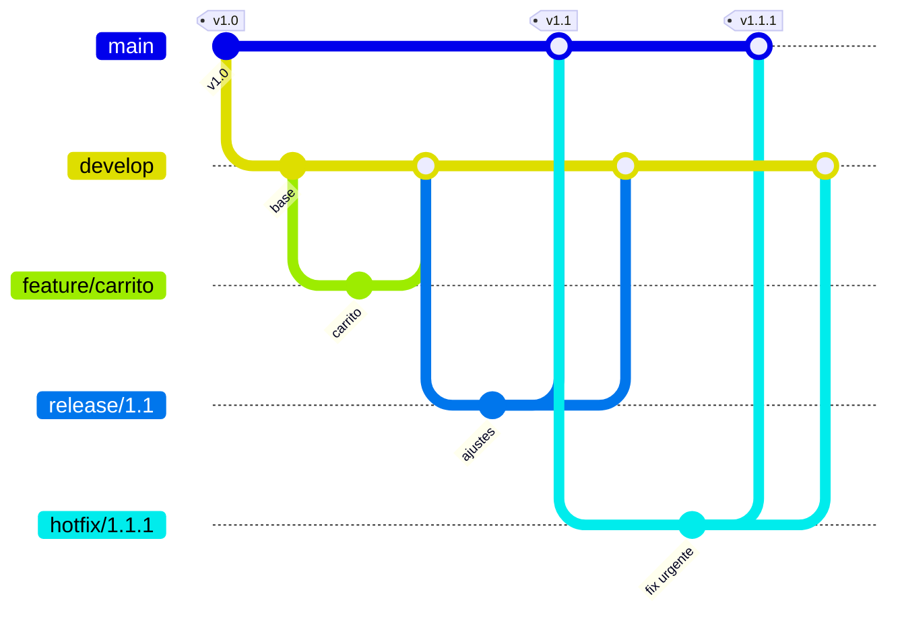

# Módulo 7 · Estrategias de ramificación y buenas prácticas

## Objetivos

- Comparar **GitHub Flow** y **Git Flow** y saber cuándo usar cada uno.
- Nombrar ramas y escribir mensajes de commit de forma consistente.
- Llevarte un resumen de comandos: [CHEATSHEET.md](../../CHEATSHEET.md).

## 1. GitHub Flow

Una sola rama permanente (`main`), que **siempre se puede desplegar**. Todo lo demás son ramas cortas.



1. Crea una rama desde `main`.
2. Haz commits y súbelos.
3. Abre un Pull Request.
4. Revisión y pruebas.
5. Merge a `main` → despliegue.

Es exactamente lo que hiciste en el módulo 6.

## 2. Git Flow

Varias ramas permanentes y tipos de rama con roles fijos. Pensado para software con **versiones
numeradas** (v1.0, v1.1, v2.0...).



| Rama | Para qué | Sale de | Se fusiona en |
|---|---|---|---|
| `main` | Código en producción, con tags de versión | — | — |
| `develop` | Integración del trabajo en curso | `main` | — |
| `feature/*` | Nuevas funcionalidades | `develop` | `develop` |
| `release/*` | Preparar una versión (solo ajustes) | `develop` | `main` y `develop` |
| `hotfix/*` | Arreglos urgentes en producción | `main` | `main` y `develop` |

## 3. ¿Cuál elegir?

| | GitHub Flow | Git Flow |
|---|---|---|
| Ramas permanentes | `main` | `main` + `develop` |
| Complejidad | Baja | Alta |
| Ideal para | Webs y apps con despliegue continuo | Software con versiones (apps móviles, librerías, instaladores) |
| Despliegues | Varias veces al día | Por versión planificada |

**Recomendación:** empieza con **GitHub Flow**. Pasa a algo más complejo solo cuando tengas un problema real
que lo justifique (p. ej. mantener varias versiones a la vez).

## 4. Convenciones de nombres de ramas

Formato: `tipo/descripcion-corta-con-guiones`

| Prefijo | Uso | Ejemplo |
|---|---|---|
| `feature/` | Nueva funcionalidad | `feature/galeria-de-fotos` |
| `fix/` | Corrección de un error | `fix/link-roto-footer` |
| `hotfix/` | Corrección urgente en producción | `hotfix/pago-duplicado` |
| `docs/` | Solo documentación | `docs/instrucciones-instalacion` |
| `refactor/` | Reorganizar código sin cambiar comportamiento | `refactor/estilos-header` |
| `chore/` | Mantenimiento (dependencias, configuración) | `chore/actualizar-gitignore` |

Reglas: minúsculas, guiones en vez de espacios, sin acentos ni caracteres especiales, descriptivo pero
corto. Si usan un gestor de tareas, incluye el número: `feature/123-galeria`.

## 5. Mensajes de commit claros

Un buen mensaje responde: **¿qué hace este commit?** Quien lea el historial en 6 meses (quizás tú) lo
agradecerá.

**Reglas:**

1. **Modo imperativo**, como una orden: "Agrega", "Corrige", "Elimina" (no "Agregué" ni "Agregando").
   Truco: debe completar la frase *"Si aplico este commit, ... "*.
2. **Primera línea de 50 caracteres o menos**, sin punto final.
3. Si hace falta más detalle: **línea en blanco** y luego un cuerpo explicando el **porqué**.
4. **Un cambio lógico por commit.** Si el mensaje necesita "y", quizá son dos commits.

| ❌ Malo | ✅ Bueno |
|---|---|
| `cambios` | `Agrega sección de contacto` |
| `fix` | `Corrige link roto en el footer` |
| `asdfg` | `Elimina estilos duplicados del header` |
| `Agregué cosas y arreglé el bug del menú` | Dos commits: `Agrega...` y `Corrige...` |

Con cuerpo (`git commit` sin `-m` abre el editor):

```
Corrige link roto en el footer

El enlace apuntaba a /contacto.html, que se renombró a /contacto/
en el commit a1b2c3d.
```

### Conventional Commits (opcional)

Convención muy usada que añade un **tipo** al inicio. Permite generar changelogs y versiones de forma
automática:

```
feat: agrega galería de fotos
fix: corrige link roto en el footer
docs: actualiza instrucciones de instalación
style: ajusta espaciado del header
refactor: simplifica estilos de la galería
chore: actualiza .gitignore
```

Más información: <https://www.conventionalcommits.org/es/>

## 6. Otras buenas prácticas

- **Commits pequeños y frecuentes**: más fáciles de revisar y de revertir.
- **`git pull` antes de empezar** a trabajar y antes de crear una rama.
- **Ramas de vida corta**: cuanto más vive una rama, más conflictos acumula.
- **Nunca subas secretos** (contraseñas, tokens, `.env`): agrégalos al `.gitignore`. Si ya se subieron,
  cámbialos de inmediato: quedan en el historial.
- **Revisa antes de hacer commit**: `git status` y `git diff --staged`.
- **No reescribas historia compartida** (`rebase`, `push --force`) en ramas que otros usan.
- **Protege `main`** y haz que todo pase por Pull Request.

## 🛠️ Práctica final

> 📽️ **Slide 35.** Un último PR al repo del curso, siguiendo **GitHub Flow** y las convenciones de este módulo:

1. Rama con prefijo y tu usuario, desde lo último de GitHub:

   ```bash
   git fetch
   git switch -c docs/tu-usuario origin/main
   ```

2. Añade a tu archivo de gustos qué fue lo que más te gustó del curso y haz commit con un mensaje en
   **imperativo** de 50 caracteres o menos (prueba Conventional Commits):

   ```bash
   echo "Lo que más me gustó del curso: resolver conflictos" >> gustos/tu-usuario.txt
   git commit -am "docs: agrega lo que más me gustó del curso"
   git push -u origin docs/tu-usuario
   ```

3. Abre el PR, pide la revisión a un compañero, fusiónalo cuando lo apruebe y **borra la rama**.

### ✅ Comprueba que lo lograste

```bash
git fetch --prune
git log --oneline origin/main -10
```

Los mensajes están en imperativo y se entienden sin abrir los archivos. Tu rama `docs/tu-usuario` ya no
aparece en `git branch -r` porque se borró al fusionarla.

---

[← Módulo 6](../06-pull-requests/README.md) · [Inicio](../../README.md) · [Resumen de comandos →](../../CHEATSHEET.md)
